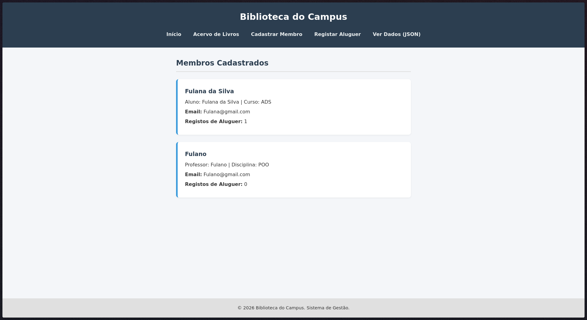
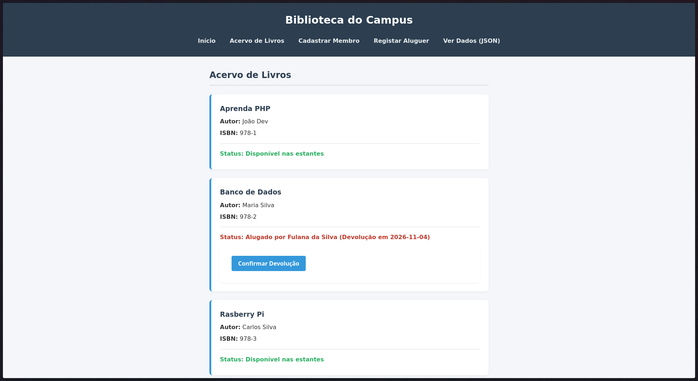
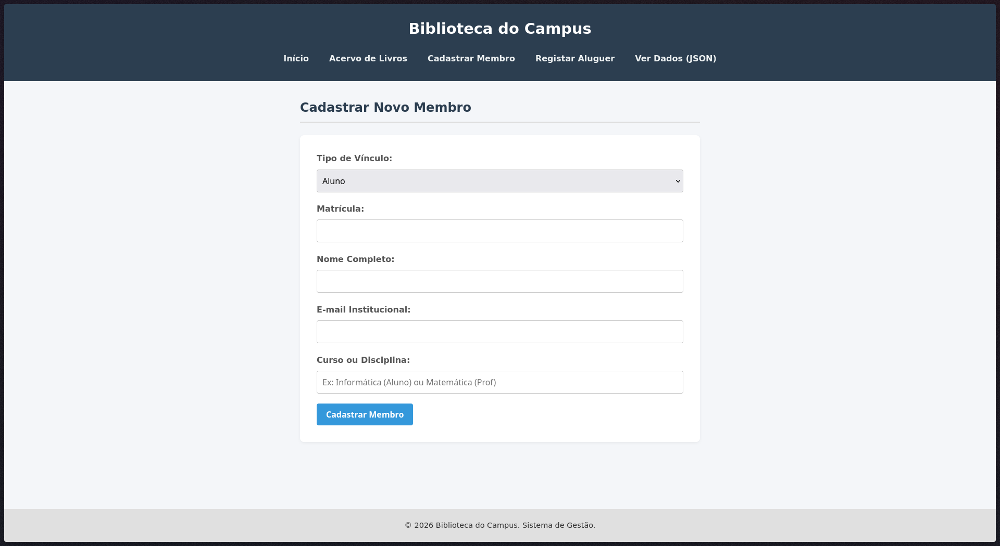
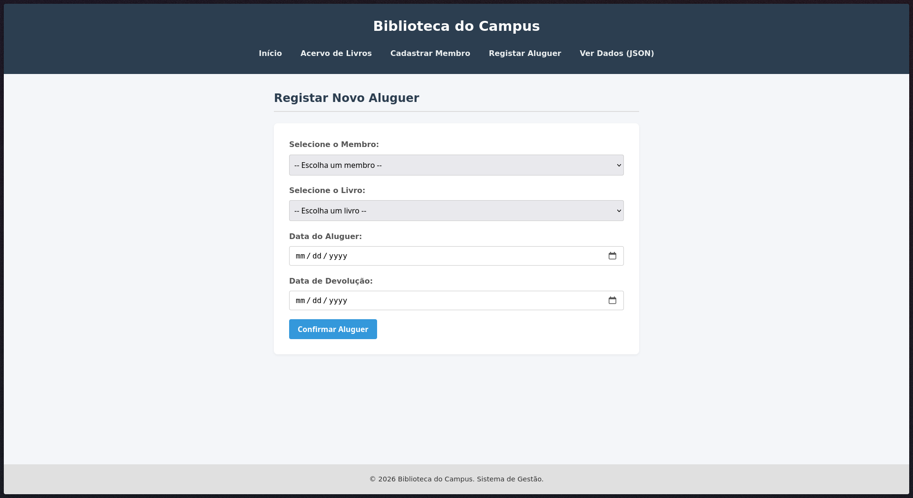

# Sistema de Gestão da Biblioteca do Campus

> Trabalho individual de Programação Web I (IFCE Campus Boa Viagem): sistema web orientado a objetos em PHP.

**Autor(a):** Dan Mendes de Souza Nogueira Ribeiro
**Tema:** 02 Biblioteca do Campus
**Vídeo:** https://youtu.be/MEnWLYgS-co?si=6WsB0uuAYJanuRur

## O problema

O sistema resolve o problema de gestão de controle de acervo em uma biblioteca educacional. Ele foi desenvolvido para auxiliar administradores do campus a registrar usuários, esse sendo os alunos e professores, controlar a disponibilidade de livros físicos nas estantes e acompanhar as datas de aluguel e devolução, evitando conflitos de empréstimos simultâneos e centralizando os dados em um arquivo JSON.

## Como executar

Requisitos: PHP 8.3 ou superior.

```bash
git clone https://github.com/playsonic/pweb1-trabalho-oo.git
cd pweb1-trabalho-oo
php -S localhost:8000 -t public -d display_errors=1 -d output_buffering=0

```

Abra http://localhost:8000

Para rodar o roteiro de testes no terminal:

```bash
php teste.php

```

## Telas






## Rotas

| URL | O que mostra | Método | Status |
|---|---|---|---|
| `/` ou `/?pagina=home` | Lista de membros cadastrados e a quantidade de registros de aluguel | GET | 200 |
| `/?pagina=livros` | Acervo de livros e o status atual de disponibilidade ou devolução | GET | 200 |
| `/?pagina=cadastro` | Formulário para cadastrar novos alunos ou professores | GET | 200 |
| `/?pagina=alugar` | Formulário para registrar um novo aluguel de livro | GET | 200 |
| `/?pagina=inexistente` | Página de erro informando que o acesso não existe no sistema | GET | 404 |
| `/?formato=json` | Retorna todos os dados da aplicação convertidos para formato JSON | GET | 200 |
| `/?pagina=cadastro` (formulário) | Processa a criação de um usuário e salva no arquivo `dados.json` | POST | 200 |
| `/?pagina=alugar` (formulário) | Processa a validação e o registro de um novo aluguel | POST | 200 |
| `/?pagina=livros` (formulário) | Processa a devolução de um livro previamente alugado | POST | 200 |

## Regras de negócio

| Nº | Regra | Classe e método | Mensagem da exceção |
|---|---|---|---|
| 1 | O e-mail fornecido durante a criação de um usuário deve possuir um formato válido. | `Usuario` / `__construct` | "Regra 1 falhou: O e-mail '[email]' não é válido." |
| 2 | Um livro não pode ser alugado se já estiver associado a um aluguel ativo e não devolvido. | Script `index.php` / bloco de `registrar_aluguel` | "Este livro já está alugado e ainda não foi devolvido." |
| 3 | A data definida para devolução não pode ser anterior à data inicial do aluguel. | `Alugado` / `__construct` | "Regra 3 falhou: A data de devolução não pode ser anterior ao aluguel." |

## Documentação

* [Modelagem (diagrama de classes)](https://www.google.com/search?q=docs/modelagem.md)
* [Testes](https://www.google.com/search?q=docs/testes.md)
* [Diário de uso de LLM](https://www.google.com/search?q=docs/llm.md)
* [Relatório (PDF)](https://www.google.com/search?q=docs/relatorio.pdf)

## Ferramentas utilizadas

| Ferramenta | Para que usei |
| --- | --- |
| PHP 8.3 | Implementação de lógica orientada a objetos (classes abstratas e herança) e persistência via JSON. |
| VS Code | Edição do código-fonte e gestão do ambiente de desenvolvimento. |
| Git e GitHub | Controle de versão e hospedagem do repositório remoto. |
| curl | Testes de requisição HTTP para a rota de visualização de dados JSON. |
| Navegador e DevTools | Teste de navegação das páginas, submissão de formulários e depuração de layout. |
| LLM: Gemini | Na criação estrutura visual do projeto. |
| Gravador de tela: OBS Studio | Captura de vídeo para a demonstração prática do sistema em funcionamento. |
